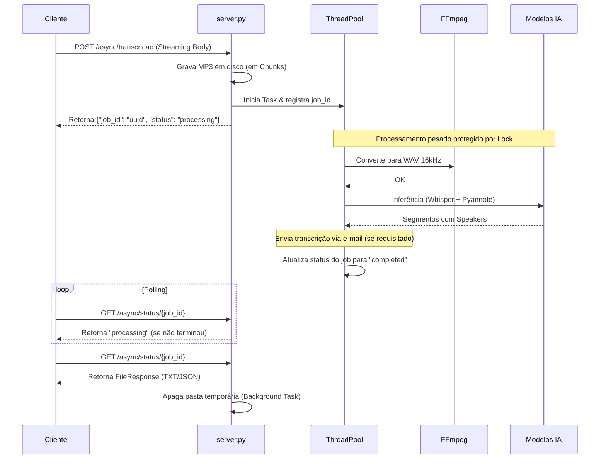

# Análise do Projeto: T.A.P. (Text & Audio Parser)

Este documento fornece uma análise técnica estruturada do projeto T.A.P., detalhando seus componentes, fluxo de dados e principais decisões arquiteturais.

> [!NOTE]
> O objetivo central do T.A.P. é abstrair a complexidade de dois modelos poderosos (Whisper e Pyannote) e fornecer uma interface simples (CLI e API) para transformar áudio bruto em transcrições com marcação de falantes.

## 1. Visão Geral

O projeto é construído em Python moderno (gerenciado via `uv`) e atua como uma ponte para dois ecossistemas de machine learning aplicados a áudio:
- **[faster-whisper](https://github.com/SYSTRAN/faster-whisper)**: Responsável por reconhecer a fala e transcrevê-la para texto, gerando timestamps precisos.
- **[pyannote.audio](https://github.com/pyannote/pyannote-audio)**: Responsável pela "diarização", que é a segmentação do áudio identificando as trocas de interlocutores.

O resultado é um processo combinado que produz um texto contínuo, porém com a marcação de qual falante (genérico, ex: `pessoa1`, `pessoa2`) proferiu cada frase.

## 2. Componentes Principais

A base de código é intencionalmente enxuta e dividida em dois pilares:

### `transcribe.py` (Core e CLI)
Contém toda a lógica pesada de negócio e ML:
- Invoca o `ffmpeg` em um subprocesso para normalizar qualquer áudio de entrada para um formato canônico exigido pelos modelos (WAV PCM, 16kHz, mono).
- Carrega e executa o modelo Whisper para obter os segmentos de texto.
- Carrega e executa o pipeline do Pyannote para obter os turnos de fala.
- Realiza a **intersecção temporal** (`assign_speakers`) mapeando os segmentos de texto para os turnos de fala.
- Exporta os resultados (JSON/TXT).

### `server.py` (Servidor HTTP FastAPI)
Uma camada web fina sobre o `transcribe.py`:
- **Modelos e Concorrência**: Carrega os modelos via Lazy Loading num cache em memória (`_cache`). Um `threading.Lock()` global garante processamento serial das inferências, evitando falhas de OOM (Out Of Memory) na GPU.
- **Proteção de Memória**: O áudio recebido não é carregado integralmente na RAM; ele é lido sob demanda via `request.stream()` e escrito direto no disco temporário.
- **API Assíncrona (Background Tasks)**: Para evitar desconexões por timeout no cliente (muito comum em transcrições longas), o processamento pesado é delegado a *Background Tasks*. O servidor devolve um `job_id` rápido, enquanto a IA roda isolada em um *threadpool*. Adicionalmente, suporta o envio automático de e-mail com a transcrição em anexo, se o usuário informar o seu contato via Query Parameter e houver um provedor SMTP configurado.

### Infraestrutura
- **Docker**: Fornece duas builds separadas (`Dockerfile.cpu` e `Dockerfile.gpu`) para minimizar o tamanho da imagem em ambientes que não possuem placas NVIDIA.
- **Knative**: Arquivo YAML pronto para deploy *Serverless* em OpenShift/Kubernetes, tirando proveito de *scale-to-zero* quando o sistema não está sendo demandado (economizando recursos computacionais consideráveis).

---

## 3. Fluxo de Dados e Arquitetura

O fluxo abaixo demonstra o que acontece quando um usuário (ou sistema) envia um áudio para o servidor.

## 4. Decisões Técnicas Notáveis

- **Uso do Faster-Whisper**: Em vez do pacote padrão da OpenAI, o projeto optou pelo `faster-whisper` (CTranslate2), que é consideravelmente mais rápido e consome menos VRAM para a mesma qualidade de saída.
- **Independência de GPU**: Ao definir a variável `WHISPER_DEVICE=cpu`, o sistema funciona perfeitamente sem GPUs (embora mais lento), o que reduz muito a barreira de adoção em CI/CD ou pods genéricos do k8s.
- **Fail-safe de Diarização**: Se a diarização falhar por falta de token (ou se a flag `--no-diarization` for usada na CLI), o projeto não quebra; ele simplesmente realiza a transcrição de texto omitindo as tags de `[pessoaX]`. Isso confere alta resiliência à aplicação.
- **Proteção contra Gargalos de Rede e RAM**: Ao combinar a leitura em *streaming* (`request.stream()`) com uma arquitetura baseada em *Polling* (`/async`), o sistema tornou-se imune a *timeouts* forçados por Proxies/Gateways (como o roteador do OpenShift) e ao erro fatal de *Out-Of-Memory* por carregar áudios gigantes inteiros na memória RAM.
